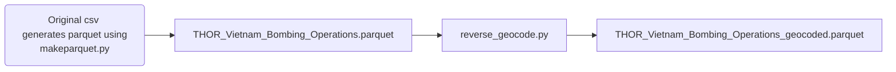
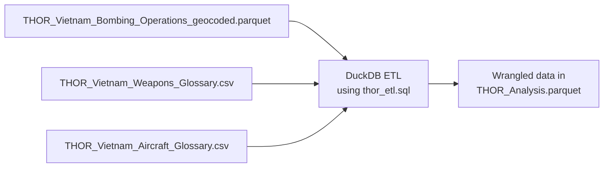
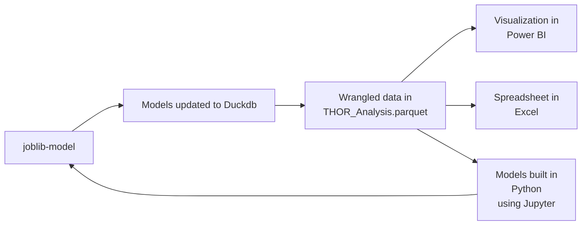

# thoranalytics
Cleansing THOR Vietnam dataset, feature extraction and data analytics.


# Prerequisites

## Python environment

Create and activate a virtual environment from the repository root in PowerShell:

```powershell
python -m venv .venv --prompt THOR
.\.venv\Scripts\Activate.ps1
```

Install the project dependencies:

```powershell
python -m pip install -r requirements.txt
```

When finished, deactivate the virtual environment with:

```powershell
deactivate
```


## DuckDB command-line tool

Install the DuckDB CLI with Windows Package Manager (`winget`) in PowerShell:

```powershell
winget install --id DuckDB.cli --exact
```

Open a new PowerShell window, then verify the installation:

```powershell
duckdb --version
```
With the Python environment activated and the DuckDB CLI installed, you can do
complete build by running:

```powershell
.\thor-build.ps1
```

## Updating the Power BI Parquet path

If you move or clone the repository to a different location, update the Power BI
`PathParquet` parameter to point to this repository's `THOR_Analysis.parquet`:

```powershell
python .\scripts\update_pbi_parquet_path.py
```


## Running Jupyter notebooks

Jupyter notebooks contain data analytics.  You can run them on your favorite
editor.

# Dataflow

Data manipulation is carried out by DuckDB.
Data analytics are carried done in Jupyter and exported as joblibs.
Data visualizations in PowerBI.
Excel can be used for random spreadsheet modeling.


## Geocoding

Original data is improved with better country identifying data.




This step can be executed by
```powershell
python .\scripts\reverse_geocode.py
```


## Training data for models

Data is extracted from previous step and appended with additional columns
from csv-files.




This step can be executed with

```powershell
Get-Content .\sql\thor_etl.sql | duckdb
```


## Model building

Model building is an iterative loop where model results are written back to
Thor_Analysis.parquet and iterated again.



Run Notebook and it generates a joblib-file to directory [Model](model/) 


Generated joblib model generates csv-files with following command.


```powershell
python .\scripts\predict_hochiminhtrail.py
```

Generated file is in directory [predictions](predictions/) and can be uploaded
to database by following command.


``powershelll
Get-Content .\sql\thor_modelupdate.sql | duckdb
``


