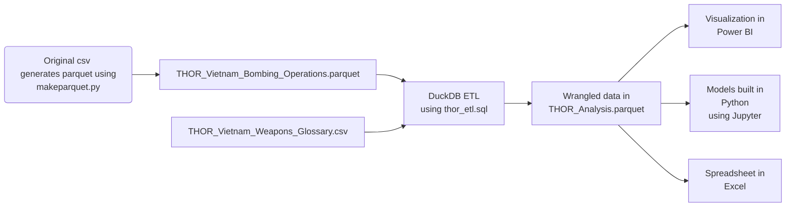

# thoranalytics
Cleansing THOR Vietnam dataset, feature extraction and data analytics.


# Dataflow

Data manipulation is carried out by DuckDB.
Data analytics are carried out by Python.
Data visualizations in PowerBI.
Excel can be used for random spreadsheet modeling.




# Prerequisites

## Python environment

Create and activate a virtual environment from the repository root in PowerShell:

```powershell
python -m venv .venv --prompt THOR
.\.venv\Scripts\Activate.ps1
```

Install the project dependencies:

```powershell
python -m pip install -r requirements.txt
```

When finished, deactivate the virtual environment with:

```powershell
deactivate
```

## DuckDB command-line tool

Install the DuckDB CLI with Windows Package Manager (`winget`) in PowerShell:

```powershell
winget install --id DuckDB.cli --exact
```

Open a new PowerShell window, then verify the installation:

```powershell
duckdb --version
```

# Operating instructions

## Running the ETL

```powershell
Get-Content .\sql\thor_etl.sql | duckdb
```

## Updating the Power BI Parquet path

If you move or clone the repository to a different location, update the Power BI
`PathParquet` parameter to point to this repository's `THOR_Analysis.parquet`:

```powershell
python .\scripts\update_pbi_parquet_path.py
```

## Reverse geocoding target coordinates

```powershell
python .\scripts\reverse_geocode.py
```

This reads `THOR_Vietnam_Bombing_Operations.parquet` and writes a separate
`THOR_Vietnam_Bombing_Operations_geocoded.parquet`, preserving all original
rows and columns. Use `--input` and `--output` to choose different paths; an
existing output is replaced, but the input cannot be used as the output.

The script uses `TGTLATDD_DDD_WGS84` and `TGTLONDDD_DDD_WGS84` (the longitude
column's actual spelling in the source). It adds `GEOCODE_NAME`,
`GEOCODE_ADMIN1`, `GEOCODE_ADMIN2`, and `GEOCODE_COUNTRY_CODE` from
`reverse_geocoder`. These describe the nearest populated place, not necessarily
the administrative area containing the target, and are not historical
boundaries. Missing or out-of-range coordinates produce null geocoding fields.
The library uses its bundled geographic data and does not make online requests.

## Running Jupyter notebooks

Jupyter notebooks contain data analytics.  You can run them on your favorite
editor.  Project prefers VS Code extension.

